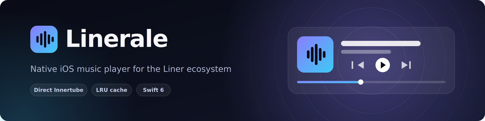
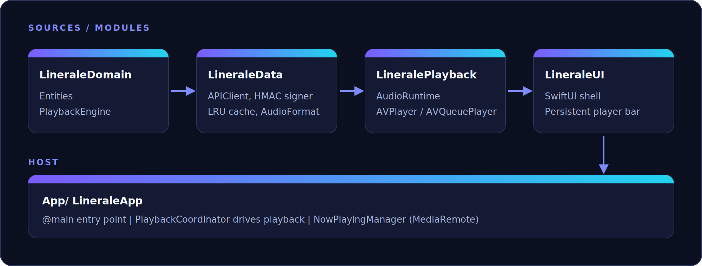

<div align="center">



<br />


</div>

## Overview

Linerale is the iOS companion to the [Liner](https://github.com/tryliner/desktop/) desktop client and mirrors its queue and caching semantics. Audio is resolved through direct Innertube streams, cached on disk with an LRU policy, and played with AVFoundation by a stateful, observable queue engine. Written in pure Swift 6 with strict concurrency.

## Features

- **Instant replays:** cached tracks play from local disk with zero network.
- **Direct Innertube:** a cache miss streams, caches and resumes automatically.
- **Stateful queue:** next-track preload, repeat (`one` / `off` / `all`), shuffle, skip recovery.
- **LRU cache:** 3 GB default limit (250 MB floor), atomic writes.
- **HMAC-signed API:** swappable `RequestSigner`, CryptoKit by default.
- **Now Playing:** lock screen and headset controls drive the engine.

## Architecture



| Module | Responsibility |
| --- | --- |
| `LineraleDomain` | Core types and the `PlaybackEngine` state machine |
| `LineraleData` | `APIClient`, HMAC signing, `LocalAudioCache`, `AudioFormat` detection |
| `LineralePlayback` | `AudioRuntime` on top of `AVPlayer`, `AVQueuePlayer` and `AVAudioEngine` |
| `LineraleUI` | SwiftUI shell with a persistent player bar |
| `App` | `@main`, `PlaybackCoordinator`, `NowPlayingManager` |

## Getting started

Requires macOS and Xcode 27.2.

```bash
swift build && swift test        # Swift Package Manager

cd App && xcodegen generate      # or generate the Xcode project
open Linerale.xcodeproj
```

> [!WARNING]
> The default signing secret is an empty placeholder and will not validate against a real verifier.

## Contributing

Issues and pull requests are welcome. Keep changes within the existing module boundaries and Swift 6 concurrency conventions.

## License

[MIT](LICENSE) &copy; 2026 Linerale contributors. Companion project to [Liner](https://github.com/tryliner/desktop/).