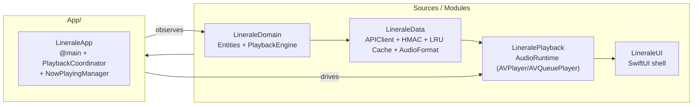
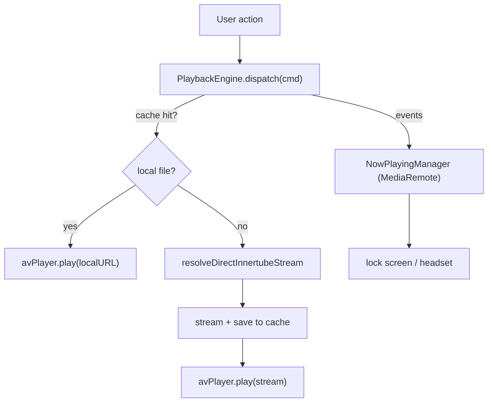

# Linerale

> The native iOS 27 music player for the [Liner](https://github.com/tryliner/desktop/) ecosystem — direct Innertube resolution, LRU audio caching, and a stateful, observable playback engine, all in pure Swift 6.

<table>
  <tr>
    <td align="center"><b>Swift</b></td>
    <td></td>
    <td align="center"><b>iOS</b></td>
    <td></td>
    <td align="center"><b>Xcode</b></td>
    <td></td>
    <td align="center"><b>License</b></td>
    <td></td>
  </tr>
</table>

Linerale mirrors the queue and caching semantics of the desktop client: it resolves
audio from **direct Innertube** streams, caches it locally with an LRU policy, and
plays it back through **AVFoundation** with a stateful, observable queue engine —
built on a multi-module Swift Package Manager workspace with strict concurrency.

---

## Architecture



**Runtime flow**



### Modules

| Module               | Responsibility                                                                 |
| -------------------- | ------------------------------------------------------------------------------ |
| `LineraleDomain`     | Core types — `Track`, `PlayerStatus`, `RepeatMode`, `PlaybackTransport` — and the `@MainActor ObservableObject` `PlaybackEngine` state machine. |
| `LineraleData`       | `APIClient` with injectable `RequestSigner` (HMAC-SHA256, `METHOD:path:timestamp:nonce:body`), `LocalAudioCache` LRU (3 GB / 250 MB floor, atomic writes), and `AudioFormat` magic-byte detection. |
| `LineralePlayback`   | `AudioRuntime`: cache-hit fast path (`AVPlayer`, zero network), cache-miss path (`AVQueuePlayer`), and an `AVAudioEngine` graph for pitch/reverb. |
| `LineraleUI`         | `LineraleRootView` / `LineraleRootViewHost` — SwiftUI shell with a persistent player bar bound to engine state. |
| `App` (host)         | `LineraleApp` (`@main`), `PlaybackCoordinator`, and `NowPlayingManager` bridging `MPNowPlayingInfoCenter` / `MPRemoteCommandCenter`. |

---

## Features

- **Direct Innertube** — `PlaybackTransport.directInnertube` (`"direct_innertube"`) matches the server/desktop wire form.
- **Fast-path playback** — a cache hit streams from local disk via `AVPlayer` with zero network; a miss streams, caches, and resumes.
- **Stateful queue engine** — single-next preload, `repeat` (`one` / `off` / `all`), shuffle, and desktop-faithful auto-end semantics (`repeat = one` honored only on auto-end).
- **Skip recovery** — `MAX_CONSECUTIVE_AUTO_SKIPS = 3` guards against runaway skips.
- **LRU audio cache** — configurable via `LocalAudioCache.limitBytes`; atomic write-then-replace.
- **HMAC-signed API** — canonical `METHOD:path:timestamp:nonce:body` scheme with a CryptoKit default; swappable per environment.
- **Now Playing** — lock-screen and headset controls drive the engine.
- **Observable** — `@MainActor ObservableObject` engine powers SwiftUI declaratively.

---

## Requirements

| Tool   | Minimum   |
| ------ | --------- |
| Xcode  | 27.2      |
| Swift  | 6.4+      |
| iOS    | 27.0 (GA) |

---

## Getting started

> ⚠️ Building requires macOS + Xcode 27.2. Codemagic builds from this repository.

**Option A — Swift Package Manager**

```bash
swift build                      # build all modules
swift test                       # run the test suites
```

**Option B — generated Xcode project**

```bash
cd App
xcodegen generate               # -> Linerale.xcodeproj
open Linerale.xcodeproj
```

Run on a simulated iPhone:

```bash
xcodebuild test \
  -scheme Linerale \
  -destination 'platform=iOS Simulator,name=iPhone 17'
```

---

## Configuration

`APIClient` resolves streams against the running environment. Tune the signing
secret used by `HMACRequestSigner` server-side (the shipped default is an empty
placeholder and will not validate against a real verifier).

| Concern        | Where                                                                 |
| -------------- | --------------------------------------------------------------------- |
| Stream base URL | `APIClient.baseURL`                                                 |
| Signing secret  | `HMACRequestSigner(secret:)` (inject at app bootstrap)                |
| Cache limit     | `LocalAudioCache(limitBytes:)` — default 3 GB, floor 250 MB           |

---

## Testing

```bash
swift test
```

- `LineraleDomainTests` — repeat (`one` / `off` / `all`) auto-end semantics and skip recovery.
- `LineraleDataTests` — standalone-audio magic-byte detection (Matroska/webm/Ogg/FLAC/MP4).
- `LineralePlaybackTests` / `LineraleUITests` — placeholders awaiting runtime validation.

On-device validation of the AV/audio-engine pipeline is pending a macOS toolchain.

---

## Continuous integration

`codemagic.yaml` runs on every push to `main`, pinned to **Xcode 27.x** and **Swift 6.4**:

1. `swift test` (LineraleDomain + LineraleData suites)
2. `xcodegen` → `Linerale.xcodeproj`
3. `xcodebuild` archive → IPA export (see `scripts/exportOptions.plist`)

---

## Roadmap

- Drive `AVAudioEngine` pitch/reverb off `AVQueuePlayer` output.
- Wire task cancellation into `APIClient.createPlaybackSession`.
- Replace the sample-library placeholder screens once data-fetchers are wired.

---

## Contributing

Contributions are welcome. File an issue or open a pull request — keep changes strictly
to the project's existing module boundaries and Swift 6 concurrency conventions.

---

## Attributions

This project is the iOS companion to **[Liner](https://github.com/tryliner/desktop/)**,
and reproduces its queue and caching semantics. See
[`tryliner/desktop`](https://github.com/tryliner/desktop/) for the reference
implementation.

---

## License

Copyright (c) 2026 Linerale contributors.

Permission is hereby granted, free of charge, to any person obtaining a copy
of this software and associated documentation files (the "Software"), to deal
in the Software without restriction, including without limitation the rights
to use, copy, modify, merge, publish, distribute, sublicense, and/or sell
copies of the Software, and to permit persons to whom the Software is
furnished to do so, subject to the following conditions:

The above copyright notice and this permission notice shall be included in all
copies or substantial portions of the Software.

THE SOFTWARE IS PROVIDED "AS IS", WITHOUT WARRANTY OF ANY KIND, EXPRESS OR
IMPLIED, INCLUDING BUT NOT LIMITED TO THE WARRANTIES OF MERCHANTABILITY,
FITNESS FOR A PARTICULAR PURPOSE AND NONINFRINGEMENT. IN NO EVENT SHALL THE
AUTHORS OR COPYRIGHT HOLDERS BE LIABLE FOR ANY CLAIM, DAMAGES OR OTHER
LIABILITY, WHETHER IN AN ACTION OF CONTRACT, TORT OR OTHERWISE, ARISING FROM,
OUT OF OR IN CONNECTION WITH THE SOFTWARE OR THE USE OR OTHER DEALINGS IN THE
SOFTWARE.
